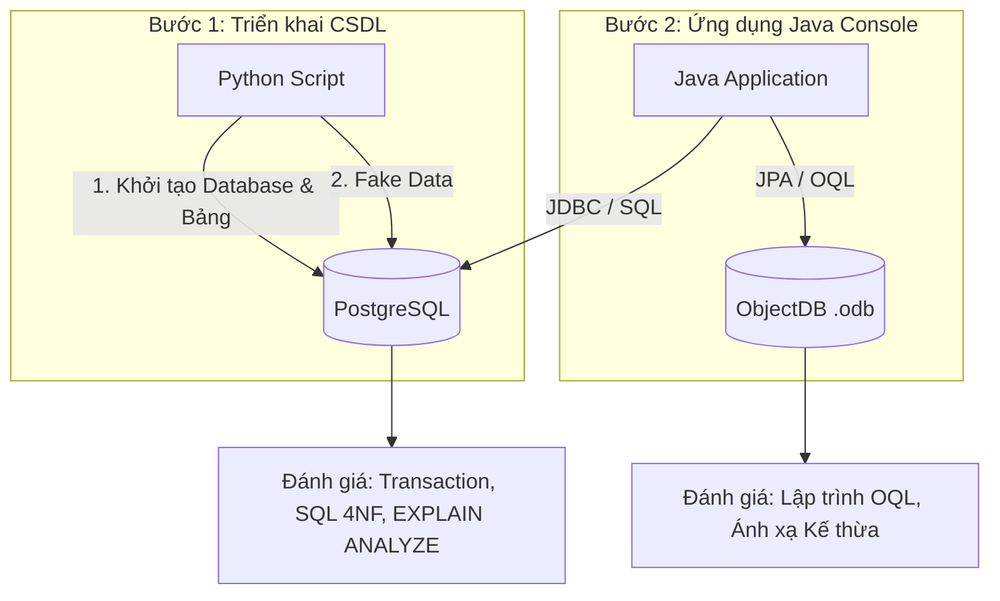

<p align="center">
  
  
  
  
</p>

# Đồ án môn học: Cơ Sở Dữ Liệu Nâng Cao (Advanced Databases)

**Chủ đề: Đề tài 3 - Thiết kế Cơ sở dữ liệu Thư viện học liệu đa phương tiện**

👥 **Nhóm thực hiện:**
- Nguyễn Thành Nhân
- Chế Văn Nam
- Hồ Minh Khuyến
- Đặng Hoàng Phúc
- Lý Nguyễn

---

## 📝 1. Giới thiệu đề tài (Mục tiêu và Phạm vi)
- **Mục tiêu:** Quản lý thống nhất sách, luận văn, video bài giảng và tài liệu điện tử; nghiên cứu kế thừa và dữ liệu đa trị.
- **Câu hỏi nghiên cứu:** Cách biểu diễn các loại học liệu và các thuộc tính đa trị ảnh hưởng thế nào đến vấn đề dư thừa dữ liệu, hiệu suất truy vấn và khả năng mở rộng của hệ thống?
- **Phạm vi quản lý:** Hệ thống quản lý Học liệu, tác giả, chủ đề (thuộc tính đa trị), bản sao sách vật lý, bạn đọc, luồng phiếu mượn trả và quyền truy cập học liệu.

## ⚙️ 2. Sơ đồ Kiến trúc & Cách hoạt động (Workflow)

Dự án được vận hành song song trên 2 hệ quản trị CSDL để phục vụ mục đích "So sánh" (Comparative Study) theo yêu cầu đồ án.



**Cách hoạt động chi tiết:**
1. Kịch bản Python `setup_library_management_db.py` sẽ đọc các file `01_schema.sql` và `02_data_sample.sql` để kết nối vào PostgreSQL, tạo các bảng (tuân thủ chuẩn hóa 4NF) và bơm dữ liệu mượn/trả mẫu.
2. Ứng dụng Java Console đóng vai trò trung tâm xử lý logic. Thông qua các tuỳ chọn trên Menu, người dùng có thể kích hoạt các chức năng chạy ngầm (truy vấn SQL đệ quy, giả lập 2 luồng tranh chấp mượn sách bằng Pessimistic Locking).
3. Ở tính năng số 6, ứng dụng Java không gọi PostgreSQL nữa mà gọi ObjectDB qua JPA, thực thi các câu lệnh **OQL (Object Query Language)** để chứng minh sự tiện lợi khi không cần `JOIN` bảng.

## 📂 3. Cấu trúc Mã nguồn
```text
CSDLNC_ThuVienHocLieu/
├── src/                # Toàn bộ mã nguồn Java (Console App kết nối cả PostgreSQL & ObjectDB)
│   ├── main/java       # Code DAO, Service, Models
│   └── main/resources  # File cấu hình JPA (persistence.xml) và Script SQL chính thức
├── docs/               # Chứa toàn bộ báo cáo phân tích, sơ đồ EER và So sánh (SQL vs OQL)
├── scripts/            # Kịch bản Python tự động tạo Database, sinh Mock Data
├── pom.xml             # Tệp cấu hình thư viện Maven (PostgreSQL Driver, ObjectDB)
└── run.bat / mvn.cmd   # Script khởi chạy chương trình nhanh chóng
```

## 🚀 4. Hướng dẫn Khởi chạy và Tải môi trường

### Yêu cầu cài đặt môi trường:
Để máy tính có thể biên dịch và chạy dự án này, bạn cần cài đặt các công cụ sau:
1. **Java JDK 17+:** [Tải tại đây](https://www.oracle.com/java/technologies/javase/jdk17-archive-downloads.html). Nhớ cấu hình biến môi trường `JAVA_HOME`.
2. **PostgreSQL 14+:** [Tải tại đây](https://www.postgresql.org/download/). (Mật khẩu mặc định lúc cài đặt cấu hình là `12345` để khớp với script, nếu khác hãy sửa lại trong file Python).
3. **Python 3.10+:** [Tải tại đây](https://www.python.org/downloads/). Cài thêm thư viện bằng lệnh: `pip install psycopg2 faker`.
4. **Apache Maven:** [Tải tại đây](https://maven.apache.org/download.cgi). (Đã tích hợp sẵn file `mvn.cmd` nên có thể bỏ qua nếu máy bạn chưa cài).

### Quy trình khởi chạy:
**Bước 1: Khởi tạo CSDL tự động bằng Python**
Mở Terminal tại thư mục gốc của đồ án và chạy lệnh sau để tự tạo Database `library_management` và chèn dữ liệu mẫu:
```powershell
python scripts\setup_library_management_db.py
```

**Bước 2: Biên dịch và Chạy ứng dụng Java Console**
Gõ 2 lệnh sau để Maven tự động tải thư viện ObjectDB/PostgreSQL về và khởi chạy Menu ứng dụng:
```powershell
.\mvn.cmd clean compile
.\run.bat
```
*(Chương trình sẽ hiển thị Menu Console từ 1-7 để bạn kiểm chứng trực tiếp từng yêu cầu của Đề tài 3).*

## 📚 5. Tài liệu tham khảo
1. **Fundamentals of Database Systems:** Đọc Chương 4 về EER, Chương 12 về CSDL đối tượng và Chương 15 về thuật toán thiết kế, các phụ thuộc nâng cao. [pearson.com](https://www.pearson.com)
2. **Database System Concepts – bài giảng:** Sử dụng phần *Relational Database Design* để nghiên cứu phụ thuộc và chuẩn hóa. slides
3. **ObjectDB – Developer's Guide:** Tham khảo nếu nhóm triển khai thêm bản mẫu lưu trữ đối tượng. [ObjectDB](https://www.objectdb.com)