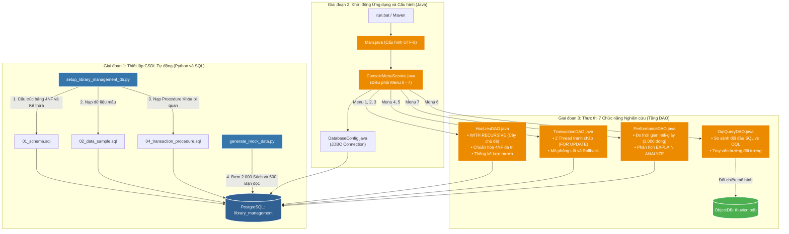

<p align="center">
  
  
  
  
</p>

# Đồ án môn học: Cơ Sở Dữ Liệu Nâng Cao (Advanced Databases)

**Chủ đề: Đề tài 3 - Thiết kế Cơ sở dữ liệu Thư viện học liệu đa phương tiện**

👥 **Nhóm thực hiện:**
- Nguyễn Thành Nhân
- Chế Văn Nam
- Hồ Minh Khuyến
- Đặng Hoàng Phúc
- Lý Nguyễn

---

## 📝 1. Giới thiệu đề tài (Mục tiêu và Phạm vi)
- **Mục tiêu:** Quản lý thống nhất sách, luận văn, video bài giảng và tài liệu điện tử; nghiên cứu kế thừa và dữ liệu đa trị.
- **Câu hỏi nghiên cứu:** Cách biểu diễn các loại học liệu và các thuộc tính đa trị ảnh hưởng thế nào đến vấn đề dư thừa dữ liệu, hiệu suất truy vấn và khả năng mở rộng của hệ thống?
- **Phạm vi quản lý:** Hệ thống quản lý Học liệu, tác giả, chủ đề (thuộc tính đa trị), bản sao sách vật lý, bạn đọc, luồng phiếu mượn trả và quyền truy cập học liệu.

## ⚙️ 2. Sơ đồ Kiến trúc & Dòng chảy Hoạt động (Workflow)

Dự án được thiết kế theo kiến trúc phân tầng chuyên nghiệp, kết hợp tự động hóa giữa **Python**, **PostgreSQL** và **Java Console**:



---

## 📊 3. Sơ đồ Thực thể EER (Enhanced Entity-Relationship)
Hệ thống được mô hình hóa theo đúng chuẩn học thuật môn Cơ sở dữ liệu Nâng cao:
* **Lớp cha & Kế thừa (Class Table Inheritance):** `HocLieu` đóng vai trò lớp cha; 4 lớp con rời rạc (*Disjoint `d`*): `Sach`, `LuanVan`, `VideoBaiGiang`, `TaiLieuDienTu`.
* **Thuộc tính đa trị (Chuẩn hóa 4NF):** `HocLieu - TacGia` (N:M) và `HocLieu - ChuDe` (N:M).
* **Quan hệ đệ quy (Recursive Relationship):** `ChuDeCha` tự tham chiếu 1:N trên chính thực thể `ChuDe`.
* **Luồng mượn trả & Giao dịch:** `HocLieu` (1:N) $\rightarrow$ `BanSao` (N:1) $\rightarrow$ `PhieuMuon` (1:N) $\leftarrow$ `BanDoc`.

> 📁 **Tệp sơ đồ trong dự án:**
> * **Tệp sơ đồ Vector EER:** [`SoDoEER.svg`](SoDoEER.svg)
> * **Cách sử dụng:**
>   * **Chèn vào Báo cáo Word / Slide:** Chọn *Insert > Pictures > This Device* chọn file `SoDoEER.svg` (giữ nguyên độ nét vector 100%, không bị vỡ hạt khi in).
>   * **Xem, chỉnh sửa và xuất ảnh trên svgviewer.dev:** Truy cập [svgviewer.dev](https://www.svgviewer.dev/), kéo thả file `SoDoEER.svg` vào (hoặc dán code) để xem trước trực quan, chỉnh sửa văn bản trực tiếp và xuất ảnh PNG độ phân giải cao (2x/4x) phục vụ báo cáo.

---

## 📂 4. Cấu trúc Mã nguồn Dự án
```text
CSDLNC_ThuVienHocLieu/
├── SoDoEER.svg                 # Sơ đồ thực thể EER chuẩn Vector (Mở bằng svgviewer.dev / chèn vào Word)
├── src/main/java/com/library/
│   ├── Main.java               # Điểm bắt đầu (Entry point), cấu hình UTF-8 Console
│   ├── config/
│   │   └── DatabaseConfig.java # Cung cấp kết nối JDBC tới PostgreSQL
│   ├── dao/
│   │   ├── HocLieuDAO.java     # Xử lý SQL đệ quy (CTE), đa trị 4NF và thống kê
│   │   ├── TransactionDAO.java # Mô phỏng 2 Thread tranh chấp (Locking) & Rollback
│   │   ├── OqlQueryDAO.java    # Bảng so sánh đối đầu trực quan SQL vs OQL (ObjectDB)
│   │   └── PerformanceDAO.java # Đo thời gian thực thi (ms) và EXPLAIN ANALYZE
│   ├── model/                  # 10 Entities Java ánh xạ mô hình đối tượng
│   └── service/
│       └── ConsoleMenuService.java # Giao diện Menu tương tác người dùng (Menu 0-7)
├── src/main/resources/
│   ├── 01_schema.sql           # Khởi tạo bảng, khóa chính, khóa ngoại, kế thừa
│   ├── 02_data_sample.sql      # Dữ liệu mẫu ban đầu (sách, bạn đọc, danh mục)
│   └── 04_transaction_procedure.sql # Stored Procedure có khóa bi quan (FOR UPDATE)
├── docs/                       # Toàn bộ tài liệu đặc tả, phân tích lý thuyết, so sánh SQL vs OQL
├── scripts/
│   ├── setup_library_management_db.py # Tự động tạo DB, Reset schema, chạy 3 file SQL
│   └── generate_mock_data.py   # Tự động bơm 500 bạn đọc & 2.000 học liệu (Big Data)
├── pom.xml                     # Quản lý thư viện Maven (PostgreSQL JDBC, ObjectDB JPA)
└── run.bat / mvn.cmd           # Script khởi chạy chương trình nhanh chóng
```

---

## 🚀 5. Hướng dẫn Khởi chạy và Kịch bản Kiểm thử

### Yêu cầu môi trường:
1. **Java JDK 17+:** Đã cấu hình biến môi trường `JAVA_HOME`.
2. **PostgreSQL 14+:** Đang chạy dưới dạng Service (Tài khoản: `postgres` / Mật khẩu mặc định: `12345`).
3. **Python 3.10+:** Cài đặt 2 thư viện hỗ trợ:
   ```powershell
   pip install psycopg2 faker
   ```

---

### Quy trình khởi chạy 3 bước:

#### Bước 1: Khởi tạo CSDL tự động (Bắt buộc)
Tại thư mục gốc dự án, chạy lệnh:
```powershell
python scripts\setup_library_management_db.py
```
*(Lệnh này tự động tạo database `library_management`, dọn sạch schema cũ và nạp cấu trúc 3 file SQL).*

#### Bước 2: Nạp dữ liệu lớn - Big Data (Khuyên dùng)
Chạy script sinh **500 Bạn đọc** và **2.000 Cuốn sách** ngẫu nhiên phục vụ kiểm thử hiệu năng:
```powershell
python scripts\generate_mock_data.py
```

#### Bước 3: Biên dịch và Khởi chạy ứng dụng Java Console
```powershell
.\mvn.cmd clean compile
.\run.bat
```

---

### 🎯 Kịch bản Demo 7 Chức năng "Ăn điểm" trước Giảng viên:

Khi ứng dụng Console xuất hiện, bạn lần lượt demo theo các tính năng trọng tâm sau:

* **Chọn Menu 1:** Tra cứu danh mục chủ đề phân cấp bằng truy vấn đệ quy **`WITH RECURSIVE`** trong PostgreSQL.
* **Chọn Menu 2:** Truy vấn học liệu có nhiều chủ đề $\rightarrow$ Minh chứng kỹ thuật tách bảng trung gian chuẩn hóa **4NF**.
* **Chọn Menu 3:** Thống kê số lượt mượn học liệu $\rightarrow$ Minh chứng hàm tổng hợp `COUNT()`, `GROUP BY`, `ORDER BY`.
* **Chọn Menu 4 (Trọng tâm):** Mô phỏng **2 Thread độc lập** cùng mượn 1 cuốn sách tại cùng 1 thời điểm $\rightarrow$ Minh chứng cơ chế **Khóa bi quan (Pessimistic Locking `SELECT ... FOR UPDATE`)**, chỉ 1 người mượn thành công, người còn lại bị chặn (chống Lost Update / Race Condition).
* **Chọn Menu 5:** Mô phỏng lỗi khi thực hiện giao dịch $\rightarrow$ Minh chứng cơ chế **`ROLLBACK`**, trạng thái sách được hoàn trả nguyên vẹn là `San sang` (Đảm bảo tính chất Atomicity trong ACID).
* **Chọn Menu 6 (Trọng tâm):** Bảng so sánh đối đầu trực quan giữa **SQL (PostgreSQL)** và **OQL (ObjectDB)** $\rightarrow$ Chứng minh OQL duyệt kế thừa và collection bằng dấu chấm (`.`) mà **hoàn toàn không cần `JOIN`**, giải quyết bài toán Lệch pha trở kháng (*Impedance Mismatch*).
* **Chọn Menu 7:** Thực hiện truy vấn tìm kiếm trên **2.000 dòng dữ liệu** $\rightarrow$ Đo lường thời gian (ms) và xuất kế hoạch thực thi **`EXPLAIN ANALYZE`** để đánh giá hiệu năng.

---

## 📚 6. Tài liệu tham khảo
1. **Fundamentals of Database Systems (Elmasri & Navathe):** Chương 4 (Mô hình EER), Chương 12 (CSDL Đối tượng), Chương 15 (Chuẩn hóa 4NF).
2. **Database System Concepts (Silberschatz, Korth, Sudarshan):** Chương về Thiết kế CSDL Quan hệ và Quản lý Giao dịch đồng thời (Concurrency Control).
3. **ObjectDB Developer's Guide:** Tài liệu hướng dẫn truy vấn OQL / JPQL trên Cơ sở dữ liệu Hướng đối tượng [objectdb.com](https://www.objectdb.com).