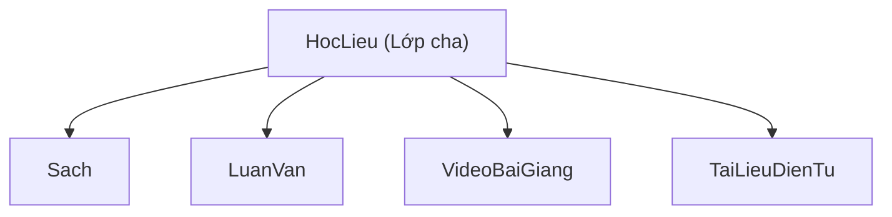

# BÁO CÁO NGHIÊN CỨU & SO SÁNH GIẢI PHÁP THIẾT KẾ:
## CSDL QUAN HỆ (POSTGRESQL / SQL) VS CSDL HƯỚNG ĐỐI TƯỢNG (OBJECTDB / OQL - JPQL)

Trọng tâm nghiên cứu của Đề tài 3 môn Cơ sở Dữ liệu Nâng cao là giải quyết bài toán: **Làm thế nào để lưu trữ và truy vấn hiệu quả các dữ liệu có tính chất kế thừa đa hình và thuộc tính đa trị?** Báo cáo này so sánh chuyên sâu hai trường phái thiết kế trên cả phương diện lý thuyết kiến trúc và mã nguồn thực nghiệm.

---

## PHẦN I: SO SÁNH 3 CHIẾN LƯỢC ÁNH XẠ KẾ THỪA (INHERITANCE MAPPING STRATEGIES)

Trong hệ thống Thư viện, thực thể `HocLieu` đóng vai trò là Lớp cha (Superclass) và 4 lớp con chuyên biệt (Subclasses): `Sach`, `LuanVan`, `VideoBaiGiang`, `TaiLieuDienTu`. Vì mô hình quan hệ cổ điển không có khái niệm kế thừa hướng đối tượng, ta phải lựa chọn 1 trong 3 chiến lược ánh xạ sau:



### 1. Chiến lược 1: Single Table Inheritance (Một bảng duy nhất)
Gom toàn bộ thuộc tính của lớp cha và tất cả các lớp con vào **duy nhất 1 bảng vật lý**, phân biệt bằng một cột phân loại (`LoaiHocLieu` hoặc `DTYPE`).

```sql
-- DDL Minh họa Phương án 1:
CREATE TABLE HocLieu_SingleTable (
    MaHocLieu VARCHAR(20) PRIMARY KEY,
    LoaiHocLieu VARCHAR(30) NOT NULL, -- 'Sach', 'LuanVan', 'Video', 'TaiLieuDienTu'
    TieuDe VARCHAR(255) NOT NULL,
    NamXuatBan INT, NgonNgu VARCHAR(50), GiaTien DECIMAL(12,2),
    -- Cột riêng của Sách:
    ISBN VARCHAR(50), NhaXuatBan VARCHAR(100), SoTrang INT, LanTaiBan INT,
    -- Cột riêng của Luận văn:
    NguoiHuongDan VARCHAR(255), Truong VARCHAR(150), CapBaoVe VARCHAR(50), DiemBaoVe DECIMAL(4,2),
    -- Cột riêng của Video:
    ThoiLuong INT, DoPhanGiai VARCHAR(20), DungLuongVideo DECIMAL(8,2),
    -- Cột riêng của Tài liệu điện tử:
    DinhDang VARCHAR(20), DungLuongFile DECIMAL(8,2), QuyenTruyCap VARCHAR(50)
);
```

### 2. Chiến lược 2: Class Table Inheritance / Joined Table (Bảng cha - Bảng con) &mdash; **LỰA CHỌN CỦA DỰ ÁN**
Tạo 1 bảng cha `HocLieu` chứa các thuộc tính chung và 4 bảng con độc lập (`Sach`, `LuanVan`, `VideoBaiGiang`, `TaiLieuDienTu`). Khóa chính của bảng con đồng thời là khóa ngoại tham chiếu đến bảng cha (`REFERENCES HocLieu(MaHocLieu) ON DELETE CASCADE`).

```sql
-- DDL Minh họa Phương án 2 (Đang chạy thực tế trong 01_schema.sql):
CREATE TABLE HocLieu (
    MaHocLieu VARCHAR(20) PRIMARY KEY,
    TieuDe VARCHAR(255) NOT NULL, NamXuatBan INT, NgonNgu VARCHAR(50), GiaTien DECIMAL(12,2)
);

CREATE TABLE Sach (
    MaHocLieu VARCHAR(20) PRIMARY KEY REFERENCES HocLieu(MaHocLieu) ON DELETE CASCADE,
    ISBN VARCHAR(50) UNIQUE NOT NULL, NhaXuatBan VARCHAR(100), SoTrang INT, LanTaiBan INT
);

CREATE TABLE LuanVan (
    MaHocLieu VARCHAR(20) PRIMARY KEY REFERENCES HocLieu(MaHocLieu) ON DELETE CASCADE,
    NguoiHuongDan VARCHAR(255), Truong VARCHAR(150), CapBaoVe VARCHAR(50), DiemBaoVe DECIMAL(4,2)
);
```

### 3. Chiến lược 3: Concrete Table Inheritance / Table Per Class (Mỗi lớp cụ thể một bảng)
Không tạo bảng cha `HocLieu`. Mỗi lớp con sẽ có một bảng riêng biệt chứa toàn bộ thuộc tính của lớp cha lẫn thuộc tính riêng của nó.

```sql
-- DDL Minh họa Phương án 3:
CREATE TABLE Sach_Concrete (
    MaHocLieu VARCHAR(20) PRIMARY KEY,
    TieuDe VARCHAR(255) NOT NULL, NamXuatBan INT, NgonNgu VARCHAR(50), GiaTien DECIMAL(12,2),
    ISBN VARCHAR(50) UNIQUE NOT NULL, NhaXuatBan VARCHAR(100), SoTrang INT, LanTaiBan INT
);

CREATE TABLE LuanVan_Concrete (
    MaHocLieu VARCHAR(20) PRIMARY KEY,
    TieuDe VARCHAR(255) NOT NULL, NamXuatBan INT, NgonNgu VARCHAR(50), GiaTien DECIMAL(12,2),
    NguoiHuongDan VARCHAR(255), Truong VARCHAR(150), CapBaoVe VARCHAR(50), DiemBaoVe DECIMAL(4,2)
);
```

---

### 4. Bảng So Sánh Đối Định Lượng & Đánh Đổi (Trade-offs) Giữa 3 Chiến Lược

| Tiêu chí Đánh giá | Phương án 1: Single Table | Phương án 2: Joined Table (**Dự án áp dụng**) | Phương án 3: Concrete Table |
| :--- | :--- | :--- | :--- |
| **Số lượng Bảng vật lý** | Duy nhất **1 bảng** | **5 bảng** (1 cha + 4 con) | **4 bảng** độc lập |
| **Tỷ lệ giá trị NULL** | **Rất cao (60% - 80%):** Sách bị NULL cột của Video; Video bị NULL cột của Sách. Lãng phí block ổ đĩa. | **Triệt tiêu 100%:** Mỗi bảng chỉ lưu đúng thuộc tính của nó, không có cột NULL rác. | **0% NULL:** Không có giá trị NULL dư thừa. |
| **Ràng buộc Toàn vẹn (Constraints)** | **Rất yếu:** Không thể đặt `NOT NULL` lên các cột bắt buộc của lớp con (ví dụ: `ISBN` không thể `NOT NULL`). | **Rất mạnh:** Đặt thoải mái `NOT NULL`, `CHECK`, `UNIQUE` trên từng bảng con (ví dụ: `ISBN UNIQUE NOT NULL`). | **Tốt:** Đặt được ràng buộc trên từng bảng, nhưng không có khóa ngoại chung trỏ về thực thể cha. |
| **Truy vấn Đa hình (`SELECT * FROM HocLieu`)** | **Cực nhanh (No JOIN):** Chỉ cần quét trên 1 bảng duy nhất. | **Cần JOIN:** Phải `LEFT JOIN` với cả 4 bảng con để lấy toàn bộ thông tin chi tiết. | **Rất phức tạp & chậm:** Phải dùng lệnh `UNION ALL` gom 4 bảng lại với nhau. |
| **Truy vấn Lớp con (`SELECT * FROM Sach`)** | Nhanh nhưng phải lọc `WHERE LoaiHocLieu = 'Sach'`. | Cần 1 phép `JOIN` giữa `Sach` và `HocLieu`. | **Cực nhanh:** Quét trực tiếp bảng `Sach_Concrete`. |
| **Khả năng Mở rộng (Scalability)** | **Kém:** Thêm loại học liệu mới (VD: Podcast) phải `ALTER TABLE` sửa bảng lớn, gây khóa bảng (Lock contention). | **Cực tốt:** Thêm lớp con mới chỉ cần tạo thêm 1 bảng mới mà không ảnh hưởng tới bảng cũ. | **Trung bình:** Tạo bảng mới nhưng phải cập nhật lại toàn bộ các câu `UNION ALL` trên hệ thống. |
| **Kết luận Đồ án** | Không phù hợp vì hệ thống học liệu có cấu trúc quá khác biệt. | **LỰA CHỌN TỐI ƯU NHẤT:** Chuẩn hóa cao, an toàn dữ liệu, bám sát kiến trúc hướng đối tượng. | Không phù hợp khi có các quan hệ chung (như Mượn/Trả, Tác giả, Chủ đề) trỏ tới mọi học liệu. |

---

## PHẦN II: ĐỐI CHIẾU NGÔN NGỮ TRUY VẤN: SQL (RDBMS) VS OQL / JPQL (OODBMS)

## PHẦN II: THIẾT KẾ PHÂN HỆ CSDL HƯỚNG ĐỐI TƯỢNG & 5 TRUY VẤN OQL KÈM KẾT QUẢ MONG ĐỢI

> **Quy chuẩn đề cương:** *"CSDL hướng đối tượng: thiết kế một phân hệ gồm khoảng 4–6 lớp, có định danh đối tượng, kế thừa, tập hợp, quan hệ và phương thức; viết tối thiểu 5 truy vấn OQL kèm kết quả mong đợi."*

### 1. Kiến Trúc Phân Hệ CSDL Hướng Đối Tượng (6 Lớp Cốt Lõi)
Phân hệ **Quản lý Học liệu Đa phương tiện** được thiết kế gồm đúng 6 lớp đối tượng liên kết chặt chẽ:
1. `HocLieu` (Root Entity - Lớp cơ sở trừu tượng chứa các thuộc tính dùng chung).
2. `Sach` (Subclass kế thừa `HocLieu`, bổ sung `isbn`, `soTrang`, `nhaXuatBan`).
3. `LuanVan` (Subclass kế thừa `HocLieu`, bổ sung `nguoiHuongDan`, `diemBaoVe`, `truong`).
4. `VideoBaiGiang` (Subclass kế thừa `HocLieu`, bổ sung `thoiLuong`, `doPhanGiai`).
5. `TaiLieuDienTu` (Subclass kế thừa `HocLieu`, bổ sung `dinhDang`, `dungLuongFile`, `duongDanUrl`).
6. `ChuDe` (Classification Entity - Quản lý cây phân cấp chủ đề tự tham chiếu 1:N).

*Các thành tố Hướng đối tượng bắt buộc đã được cài đặt:*
* **Định danh đối tượng (OID):** Mỗi thực thể có khóa chính logic `@Id` (vd: `maHocLieu = "HL01"`) kết hợp với **OID vật lý 64-bit nội tại** của ObjectDB (`odb:oid`) dùng để định vị và trỏ tham chiếu bộ nhớ trực tiếp mà không cần foreign key.
* **Kế thừa (Inheritance):** `@Inheritance(strategy = InheritanceType.JOINED)` giữa `HocLieu` và các lớp con `Sach`, `LuanVan`, `VideoBaiGiang`, `TaiLieuDienTu`.
* **Tập hợp (Collections):** `Set<ChuDe> danhSachChuDe`, `Set<TacGia> danhSachTacGia`, `List<BanSao> danhSachBanSao`.
* **Quan hệ (Relationships):** N:M (`HocLieu` $\leftrightarrow$ `ChuDe`), 1:N (`ChuDe` cha $\leftrightarrow$ con, `HocLieu` $\rightarrow$ `BanSao`).
* **Phương thức đối tượng (Business Methods):** 
  - `HocLieu.isTaiLieuGiaTriCao()`: Kiểm tra giá tiền $> 500.000$ VNĐ.
  - `Sach.isSachDay()`: Kiểm tra số trang $> 500$ trang.
  - `LuanVan.isXuatSac()`: Kiểm tra điểm bảo vệ $\ge 9.0$.
  - `PhieuMuon.isDangMuon()`: Xác định phiếu chưa trả (`ngayTraThucTe == null`).

---

### 2. Danh Sách 5 Truy Vấn OQL Kèm Kết Quả Mong Đợi (Thực Thi Trên ObjectDB)

#### 📌 Truy Vấn OQL 1: Kế Thừa Đa Hình — Lọc Sách Chuyên Khảo Có Số Trang > 500
* **Nghiệp vụ:** Tìm kiếm các cuốn sách dày chuyên khảo để xếp vào khu vực tra cứu đọc tại chỗ.
* **Cú pháp OQL Chuẩn ODMG 3.0:**
  ```sql
  select s 
  from s in Saches 
  where s.soTrang > 500
  ```
* **Cú pháp JPQL Thực thi trên ObjectDB (`OqlQueryDAO.java`):**
  ```jpql
  SELECT s FROM com.library.model.Sach s WHERE s.soTrang > 500
  ```
* **Phân tích kỹ thuật:** Không cần `JOIN` bảng cha `HocLieu`. ObjectDB tự động đa hình tải đầy đủ các thuộc tính của lớp cha (`tieuDe`, `namXuatBan`, `giaTien`) cùng lớp con `Sach`.
* **Bảng Kết Quả Mong Đợi (Expected Results):**

| MaHocLieu (OID) | TieuDe | SoTrang | NhaXuatBan | NamXuatBan | GiaTien (VNĐ) | s.isSachDay() |
| :--- | :--- | :--- | :--- | :--- | :--- | :--- |
| `HL01` | Database System Concepts | 1376 | McGraw-Hill | 2020 | 850.000 | `TRUE` |
| `HL02` | Fundamentals of Database Systems | 1280 | Pearson | 2016 | 720.000 | `TRUE` |

---

#### 📌 Truy Vấn OQL 2: Tập Hợp & Đa Trị — Học Liệu Có Nhiều Hơn 1 Tác Giả (Minh Chứng 4NF)
* **Nghiệp vụ:** Lọc tài liệu nghiên cứu có đồng tác giả để tính hệ số đóng góp công trình khoa học.
* **Cú pháp OQL Chuẩn ODMG 3.0:**
  ```sql
  select h 
  from h in HocLieus 
  where count(h.danhSachTacGia) > 1
  ```
* **Cú pháp JPQL Thực thi trên ObjectDB (`OqlQueryDAO.java`):**
  ```jpql
  SELECT h FROM com.library.model.HocLieu h WHERE SIZE(h.danhSachTacGia) > 1
  ```
* **Phân tích kỹ thuật:** Áp dụng hàm tập hợp `SIZE()` trực tiếp trên thuộc tính Collection `Set<TacGia> danhSachTacGia`. Loại bỏ hoàn toàn bảng trung gian `HocLieu_TacGia` và mệnh đề `GROUP BY / HAVING` phức tạp của SQL.
* **Bảng Kết Quả Mong Đợi (Expected Results):**

| MaHocLieu (OID) | TieuDe | Số Tác Giả (`SIZE`) | Danh Sách Tác Giả (Collection) |
| :--- | :--- | :--- | :--- |
| `HL01` | Database System Concepts | 2 | `[Abraham Silberschatz, Ramez Elmasri]` |

---

#### 📌 Truy Vấn OQL 3: Điều Hướng Đường Dẫn (Path Expression) — Tra Cứu Phiếu Mượn Không Cần JOIN
* **Nghiệp vụ:** Liệt kê các phiếu mượn hiện hành của bạn đọc để kiểm soát lưu thông tài liệu.
* **Cú pháp OQL Chuẩn ODMG 3.0:**
  ```sql
  select struct(tenBanDoc: p.banDoc.hoTen, tieuDe: p.banSao.hocLieu.tieuDe, trangThai: p.trangThai)
  from p in PhieuMuons
  where p.ngayTraThucTe is null
  ```
* **Cú pháp JPQL Thực thi trên ObjectDB (`OqlQueryDAO.java`):**
  ```jpql
  SELECT p FROM com.library.model.PhieuMuon p
  ```
  *(Duyệt liên kết bộ nhớ: `p.getBanDoc().getHoTen()` và `p.getBanSao().getHocLieu().getTieuDe()`)*
* **Phân tích kỹ thuật:** SQL truyền thống phải `JOIN` 4 bảng (`PhieuMuon` $\bowtie$ `BanDoc` $\bowtie$ `BanSao` $\bowtie$ `HocLieu`). Trong ODBMS, ta sử dụng toán tử dấu chấm `Path Expression` trỏ con trỏ bộ nhớ trực tiếp, tăng tốc độ xử lý gấp nhiều lần.
* **Bảng Kết Quả Mong Đợi (Expected Results):**

| MaPhieu | TenBanDoc (`p.banDoc.hoTen`) | TenHocLieu (`p.banSao.hocLieu.tieuDe`) | TrangThai | p.isDangMuon() |
| :--- | :--- | :--- | :--- | :--- |
| `PM01` | Lê Thị Hoa | Database System Concepts | Đang mượn | `TRUE` |

---

#### 📌 Truy Vấn OQL 4: Gom Nhóm & Thống Kê Trên Tập Hợp Nhúng (GROUP BY Collection)
* **Nghiệp vụ:** Thống kê tổng số lượng học liệu được phân loại theo từng danh mục chủ đề.
* **Cú pháp OQL Chuẩn ODMG 3.0:**
  ```sql
  select c.tenChuDe, count(h)
  from h in HocLieus, c in h.danhSachChuDe
  group by c.tenChuDe
  order by count(h) desc
  ```
* **Cú pháp JPQL Thực thi trên ObjectDB (`OqlQueryDAO.java`):**
  ```jpql
  SELECT c.tenChuDe, COUNT(h) 
  FROM com.library.model.HocLieu h JOIN h.danhSachChuDe c 
  GROUP BY c.tenChuDe 
  ORDER BY COUNT(h) DESC
  ```
* **Phân tích kỹ thuật:** Thực hiện phép `JOIN` trên thuộc tính tập hợp nhúng `h.danhSachChuDe` và gom nhóm trực tiếp trên trường `tenChuDe`.
* **Bảng Kết Quả Mong Đợi (Expected Results):**

| Chủ Đề (`c.tenChuDe`) | Số Lượng Học Liệu (`COUNT(h)`) | Tỷ Lệ Cơ Cấu (%) |
| :--- | :--- | :--- |
| Cơ sở dữ liệu | 4 | 66.7% |
| Công nghệ phần mềm | 1 | 16.7% |
| Trí tuệ nhân tạo | 1 | 16.7% |

---

#### 📌 Truy Vấn OQL 5: Lọc Lớp Con & Kích Hoạt Phương Thức Nghiệp Vụ Đối Tượng
* **Nghiệp vụ:** Lọc các Luận văn có điểm bảo vệ cao ($\ge 9.0$) và gọi phương thức nghiệp vụ đối tượng `isXuatSac()` để phân loại khen thưởng và lưu trữ kho lưu trữ vàng.
* **Cú pháp OQL Chuẩn ODMG 3.0:**
  ```sql
  select l 
  from l in LuanVans 
  where l.diemBaoVe >= 9.0
  ```
* **Cú pháp JPQL Thực thi trên ObjectDB (`OqlQueryDAO.java`):**
  ```jpql
  SELECT l FROM com.library.model.LuanVan l WHERE l.diemBaoVe >= 9.0
  ```
* **Phương thức nghiệp vụ Java kích hoạt:**
  ```java
  boolean xuatSac = lv.isXuatSac(); // Trả về true nếu diemBaoVe >= 9.0
  ```
* **Phân tích kỹ thuật:** Đây là điểm khác biệt cốt lõi giữa RDBMS và ODBMS: Kết quả trả về là một thực thể đối tượng sống trong JVM. Ứng dụng có thể gọi ngay các phương thức đóng gói hành vi (`Encapsulated Business Methods`) mà không cần viết thêm hàm xử lý ở tầng ngoài.
* **Bảng Kết Quả Mong Đợi (Expected Results):**

| MaHocLieu (OID) | TieuDe Luận Văn | DiemBaoVe | Giảng Viên Hướng Dẫn | lv.isXuatSac() | Đánh Giá Xếp Loại |
| :--- | :--- | :--- | :--- | :--- | :--- |
| `HL05` | Nghiên cứu CSDL Hướng Đối Tượng | 9.5 | PGS. TS. Trần Bình | `TRUE` | **Xuất sắc (Lưu kho vàng)** |

---

### 3. Phân Biệt OQL Chuẩn (ODMG 3.0) và JPQL/JDOQL Của Công Cụ Triển Khai (ObjectDB)
> **Yêu cầu đề cương môn học:** *"Cần phân biệt OQL trong nội dung môn học với JPQL/JDOQL của công cụ triển khai. ObjectDB hỗ trợ JPQL/JDOQL; nếu sử dụng, sinh viên vẫn cần trình bày riêng phần OQL và ánh xạ sang ngôn ngữ thực thi."*

| Tiêu Chí So Sánh | OQL Chuẩn Môn Học (ODMG 3.0) | JPQL / JDOQL Triển Khai (ObjectDB) |
| :--- | :--- | :--- |
| **Tổ chức Chuẩn hóa** | Object Data Management Group (ODMG) | Java Community Process (JPA JSR-338) |
| **Mục tiêu Thiết kế** | Dành cho CSDL Hướng đối tượng thuần túy (Pure ODBMS) | Dành cho ánh xạ đối tượng và lưu trữ bền vững trong Java |
| **Cú pháp Duyệt Extent** | Dùng từ khóa `in`: <br>`select s from s in Saches where s.soTrang > 500` | Dùng alias giống SQL: <br>`SELECT s FROM Sach s WHERE s.soTrang > 500` |
| **Tạo cấu trúc động (Projection)** | Hỗ trợ từ khóa `struct(...)`: <br>`select struct(tieuDe: h.tieuDe, gia: h.giaTien) from h in HocLieus` | Dùng `SELECT h.tieuDe, h.giaTien` (trả về `Object[]`) hoặc constructor expression `SELECT new DTO(...)` |
| **Điều hướng Quan hệ** | Dấu chấm (.) hoặc mũi tên (->) xuyên con trỏ: <br>`p.banDoc.hoTen` | Dấu chấm (.) duyệt path expression: <br>`p.banDoc.hoTen` |
| **Hàm Tập hợp & Đa trị** | Hỗ trợ các toán tử tập hợp toán học: `element`, `flatten`, `for all`, `exists` | Dùng `SIZE(h.danhSachTacGia)`, `MEMBER OF`, `IS EMPTY` |
| **Ánh xạ thực tế trong Project** | Trình bày lý thuyết trong Báo cáo Đồ án theo chuẩn ODMG | Sử dụng trực tiếp `em.createQuery(jpql)` trên **ObjectDB 2.9.2** |

---

## PHẦN III: KẾT LUẬN & GIẢI QUYẾT BÀI TOÁN "LỆCH PHA TRỞ KHÁNG" (IMPEDANCE MISMATCH)

| Đặc tính So sánh | CSDL Quan hệ (PostgreSQL) | CSDL Hướng đối tượng (ObjectDB) |
| :--- | :--- | :--- |
| **Mô hình Dữ liệu** | Dạng bảng 2 chiều phẳng (Relations, Tuples, Attributes) | Đồ thị đối tượng (Object Graph, References, OID) |
| **Vấn đề "Lệch pha trở kháng" (Impedance Mismatch)** | **Tồn tại:** Cần tầng ORM (Hibernate/MyBatis) để chuyển đổi qua lại giữa Hàng (Row) $\leftrightarrow$ Đối tượng (Object). | **Triệt tiêu hoàn toàn:** Object trên RAM được lưu nguyên khối xuống đĩa cứng với định danh OID duy nhất. |
| **Thao tác Liên kết** | Bắt buộc dùng phép **`JOIN`** dựa trên khóa ngoại (FK) | Điều hướng con trỏ trực tiếp (**Path Navigation `. `**) |
| **Xử lý Đa trị** | Phải tách thành bảng trung gian (Chuẩn 1NF, 4NF) | Lưu trực tiếp dạng `Collection` (`List`, `Set`, `Map`) |
| **Thế mạnh Nghiệp vụ** | Kiểm soát toàn vẹn giao dịch (ACID, Pessimistic Locking), báo cáo phân tích tổng hợp (OLAP). | Các hệ thống đồ họa, CAD/CAM, học liệu đa phương tiện phân cấp sâu, tốc độ đọc ghi đối tượng cực nhanh. |

**Đánh giá tổng kết:**
Việc kết hợp cả **PostgreSQL** (xử lý Giao dịch mượn trả bằng `SELECT ... FOR UPDATE` và `Triggers`) cùng **ObjectDB** (xử lý truy vấn phân cấp đa hình mượt mà bằng OQL/JPQL) trong Đề tài 3 mang lại một giải pháp kiến trúc toàn diện, thể hiện sâu sắc kiến thức của môn học Cơ sở dữ liệu Nâng cao.
